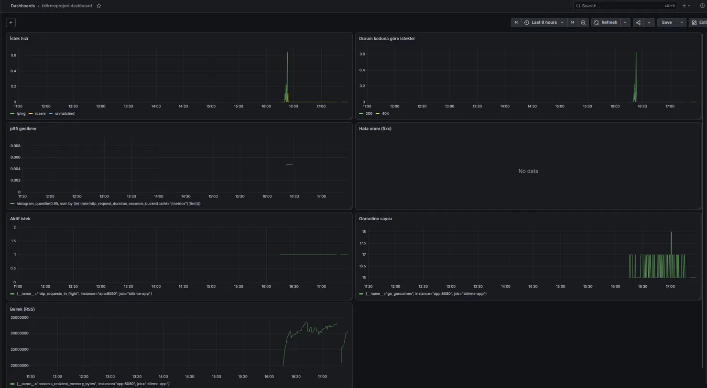

# Uçak Bileti Backend'i (bitirmeprojesi)

Go ile yazılmış bir uçak bileti alma uygulamasının REST API backend'i. Kullanıcı kaydı/girişi, uçak ve bilet yönetimi, bilet rezervasyonu gibi işlemleri sağlar. Tüm servisler `docker-compose` ile tek komutla ayağa kalkar.

## Teknolojiler

- **Dil / framework:** Go, [Gin](https://github.com/gin-gonic/gin)
- **ORM:** GORM
- **Veritabanı:** MariaDB
- **Yönetim arayüzü:** phpMyAdmin
- **Paketleme:** Docker, Docker Compose

## Endpoint'ler

| Grup | Endpoint'ler |
|---|---|
| Sağlık | `GET /ping` |
| Kullanıcı | `/users` (CRUD), `/register`, `/login`, `/logout` |
| Uçaklar | `/planes` (CRUD) |
| Biletler | `/tickets` (CRUD), `/filtertickets` |
| Rezerve biletler | `/btickets` (CRUD) |
| Rezervasyon | `POST /tickets/:id/book` (giriş gerektirir) |

## Çalıştırma

**Gereksinimler:** Docker ve Docker Compose.

**1. Repoyu klonla**

```bash
git clone https://github.com/Yiitalpp/bitirmeprojesi.git
cd bitirmeprojesi
```

**2. Ortam değişkenlerini hazırla**

Gizli bilgiler (veritabanı şifresi vb.) repoda tutulmaz. Örnek dosyayı kopyalayıp kendi değerlerinle doldur:

```bash
cp pro.env.example pro.env
```

**3. Servisleri başlat**

```bash
docker-compose up -d
docker ps
```

**4. Uygulamayı başlat (gerekirse)**

`app`, MariaDB hazır olmadan başlamaya çalışırsa kapanabilir. DB ayağa kalktıktan sonra sadece app'i tekrar başlat:

```bash
docker-compose up -d app
```

**5. Dene**

```bash
curl http://localhost:80/ping
# "pong"
```

| Servis | Adres |
|---|---|
| API | http://localhost:80 |
| phpMyAdmin | http://localhost:8000 |

---

## Güncellemeler

### Ekim 2026: Prometheus + Grafana ile izleme (monitoring)

Uygulamayı AWS'ye taşıma çalışmamın ardından, sistemi *ölçülebilir* hale getirmek için izleme katmanı ekledim. Uygulama artık Prometheus formatında metrik üretiyor, Prometheus bunları topluyor, Grafana ise dashboard'da gösteriyor.


**Ne eklendi?**

- `metrics.go`: Gin middleware'i ve `/metrics` endpoint'i
- `prometheus.yml`: Prometheus'un neyi tarayacağını tanımlar
- `grafana/`: datasource ve dashboard, kodla tanımlandığı için elle ayar gerekmez
- `docker-compose.yml`: `prometheus` ve `grafana` servisleri

**Üretilen metrikler**

| Metrik | Tip | Anlamı |
|---|---|---|
| `http_requests_total` | Counter | Method, route ve durum koduna göre toplam istek |
| `http_request_duration_seconds` | Histogram | İstek süresi (p95 gibi yüzdelikler için) |
| `http_requests_in_flight` | Gauge | O an işlenen istek sayısı |
| `go_*`, `process_*` | Çeşitli | Go runtime: goroutine, GC, bellek |

**Dashboard panelleri:** route bazında istek hızı, durum koduna göre istekler, p95 gecikme, 5xx hata oranı, aktif istek, goroutine sayısı, bellek kullanımı.



**Çalıştırma**

`.env.example` dosyasını kopyalayıp Grafana şifreni belirle:

```bash
cp .env.example .env
docker-compose up -d
```

| Servis | Adres |
|---|---|
| Prometheus | http://localhost:9090 |
| Grafana | http://localhost:3000 (kullanıcı: `admin`, şifre: `.env` içindeki) |

Dashboard, Grafana ilk açıldığında hazır gelir.

**Öğrendiklerim**

- **High cardinality:** Metrik etiketinde gerçek URL yolunu (`/tickets/8702...`) kullanırsan her bilet ID'si ayrı bir seri olur ve Prometheus'un bellek kullanımı sınırsız büyür. Bu yüzden Gin'in `c.FullPath()` değerini (`/tickets/:id` gibi şablon) kullandım.
- **Middleware sırası:** Gin'de `r.Use(...)`, yalnızca kendisinden *sonra* tanımlanan route'lara uygulanır. İlk denemede sadece `/metrics` sayılıyordu, middleware'i route tanımlarından önce taşıyınca düzeldi.
- **Etiketli metrikler boş görünebilir:** Prometheus client kütüphanesi, bir etiket kombinasyonu ilk kez gözlemlenene kadar o seriyi çıktıya yazmaz.

**Güvenlik notu:** `/metrics`, `9090` ve `3000` portlarını internete açma. Bir sunucuda çalıştırırsan erişimi kendi IP'inle sınırla.

## Lisans

Bu proje bir bitirme projesidir ve öğrenme amacıyla hazırlanmıştır.
